# Takesmith

### A teleprompter that follows you instead of making you follow it.

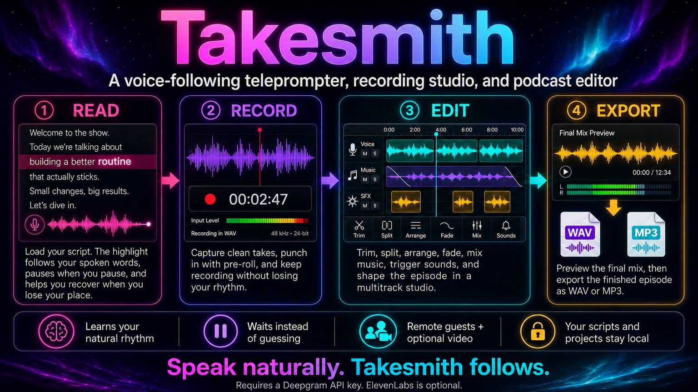

Takesmith is a local-first voice-following teleprompter and podcast studio built around a simple problem:

**People do not speak like scrolling text.**

Traditional teleprompters keep moving whether you are ready or not. Takesmith listens to what you are actually saying, keeps track of where you are in the script, waits when you stop, and helps you find your place again when you improvise, repeat yourself, or go off-script.

The goal is not to make a person sound like they are reading.

The goal is to let them speak naturally while the script keeps up.

## The prompter

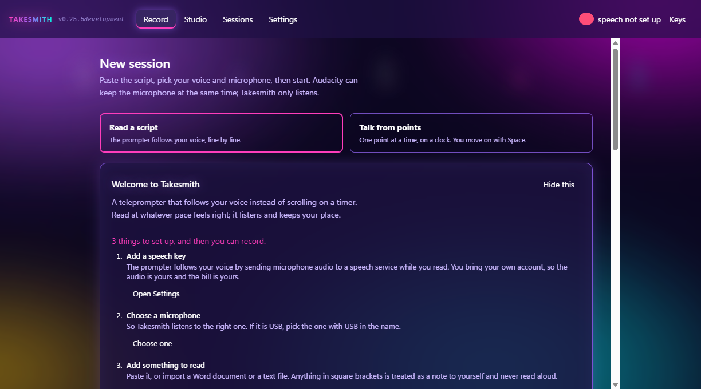

* Follows your spoken words through a script in real time
* Highlights where you currently are
* Waits when you stop speaking
* Recovers when you repeat, skip, improvise, or restart a section
* Lets you pause, slow down, speed up, repeat, restart, and skip
* Provides runway words so you can see what is coming without chasing the screen
* Walk back through a paused take a sentence at a time, and record again from that point

## Talking from points (0.25.5)

For an episode with no script. The list is your topics, split into the points you want to reach, each with a rough time, imported straight from a Word document.

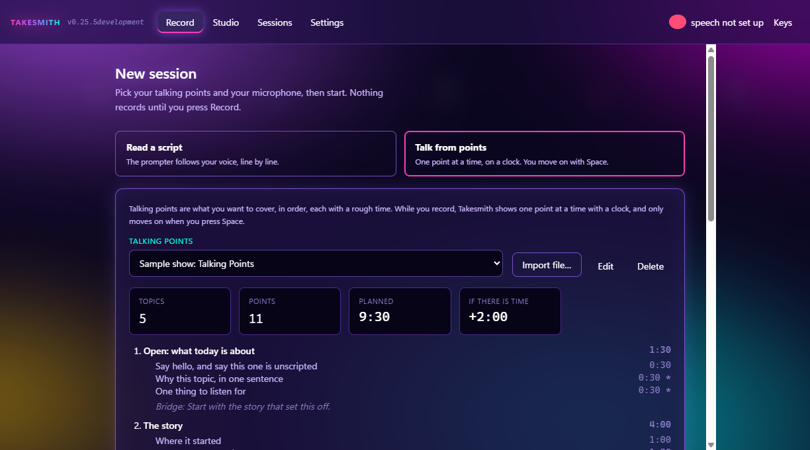

While you record, one point is on screen with a clock that changes colour as its time runs down. It never moves you on: Space does. A bridge carries you into the next topic, and the whole episode's clock sits quietly at the bottom, with whether there is room for the extra topic.

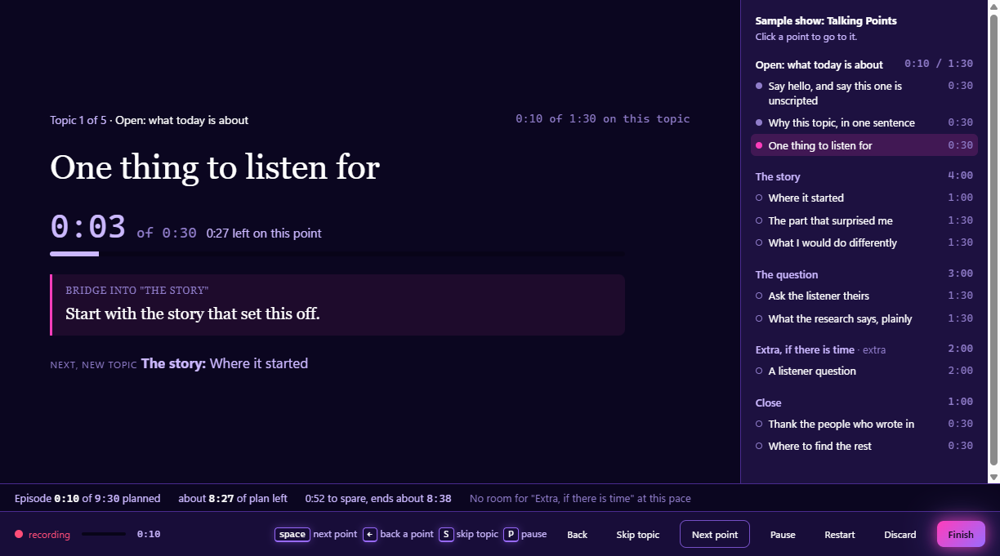

Pause to go back to any point, listen, and go again from there. The cut lands in the gap before it, and the clocks go back with it. Afterwards one button in the studio turns the topics into chapters.

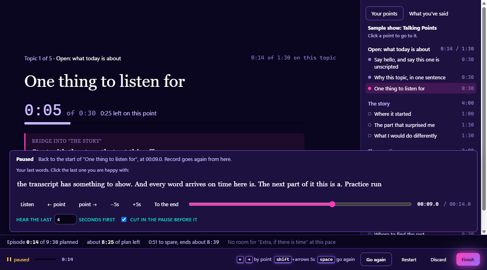

## Two cameras (0.25.6)

Plug in a second camera and both record the whole take. While you talk, press 1 or 2 to pick which one the video shows. These pictures use two test cameras the app draws for itself, one blue and one orange.

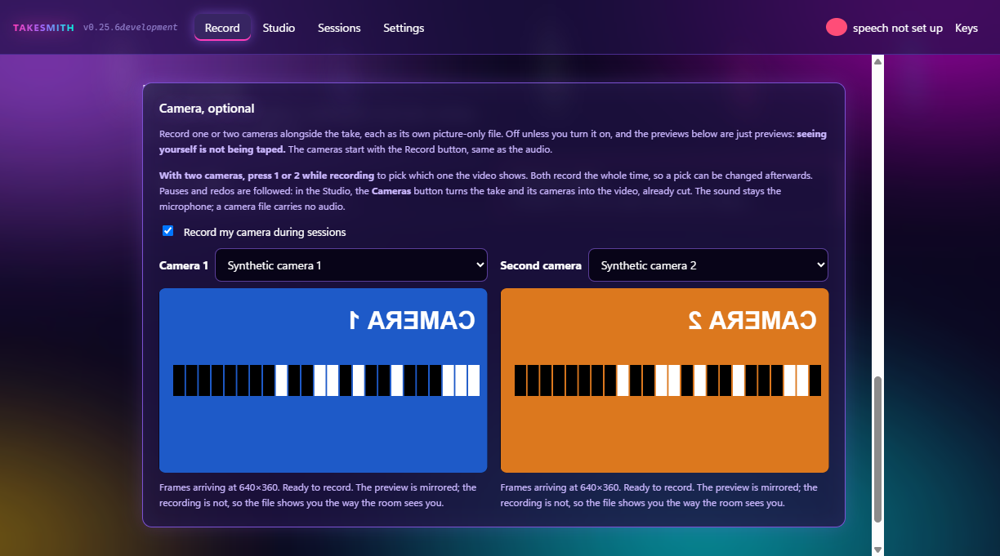

The cameras keep rolling through every pause and every fumble, but the video does not: the take keeps a clock of how much sound reached the file at each moment, so the picture can follow the sound exactly.

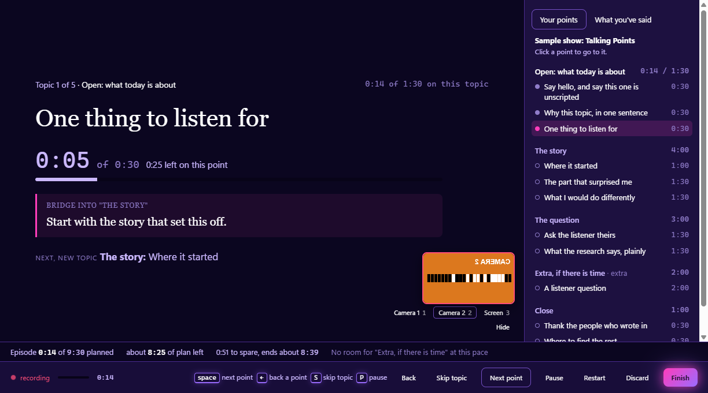

In the studio, one button cuts the cameras to the take: the camera you picked on every second, pauses and redos already cut out, lined up with the sound to within a frame. Any stretch can be switched to the other camera afterwards, because both recorded all of it.

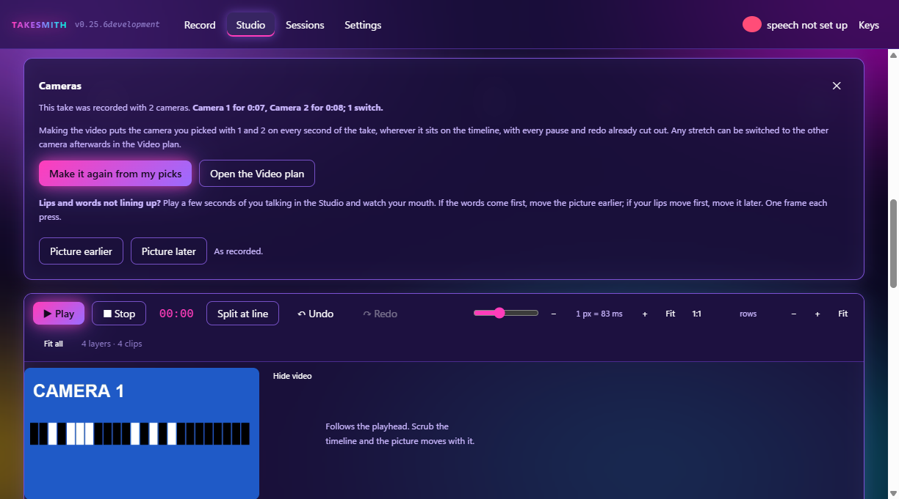

## The studio

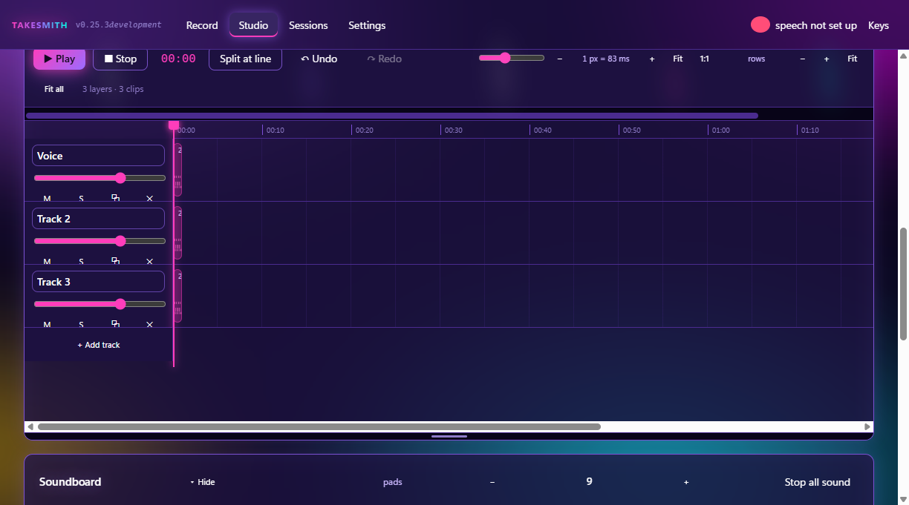

What starts as a read becomes a finished episode without leaving the app.

* A multi-layer timeline: lay music under a take, trim, split, fade and mix
* Anything you change while it is playing is heard while it is playing
* **Edit the video by selecting words in the transcript**
* See the camera while it records, and the picture plays with the audio on the timeline
* Video pickups with an alignment ghost, so a retake lines up with what is already there
* Guest cameras, and remote guests
* B-roll suggestions and poster frames
* An effects rack, running off the main thread so it never stalls the room
* **Chapters from the script itself:** the section labels you already wrote become chapter timestamps, each timed from the moment you said the first line under it
* Export to WAV or MP3

## Sessions

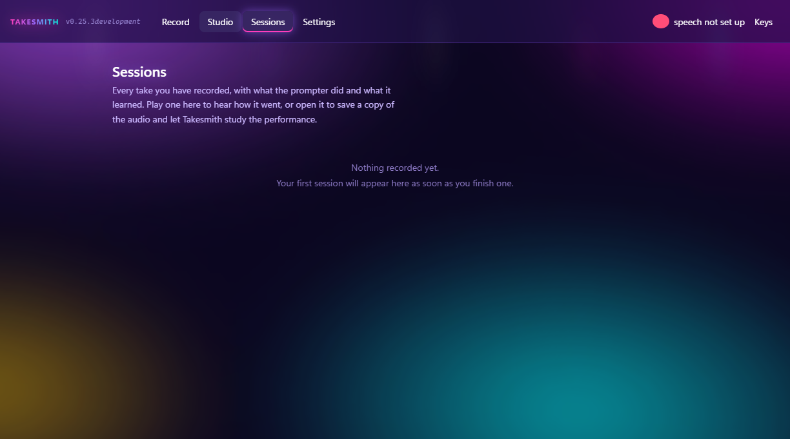

Every take is kept along with what happened during it. Nothing is thrown away because one sentence went wrong.

## Music Lab (0.26.0, in testing)

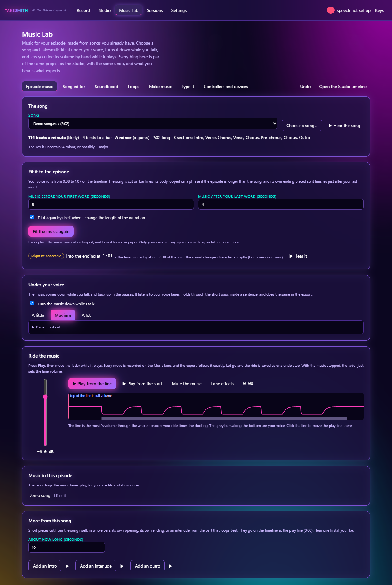

Music for the episode, made from songs you already have. Takesmith listens through a song once and finds its beat, bars, key, chords and sections. Then it fits the song under your voice on bar lines, turns it down while you talk, and lets you ride its volume by hand while it plays. Every move is recorded and the export follows it exactly.

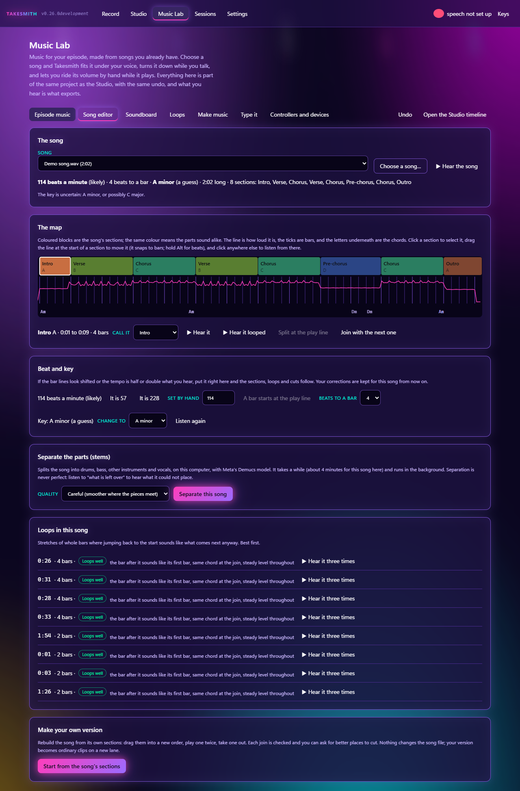

* **A song editor** that shows the song as a map you can correct, rearrange, speed up, change the key of, and split into drums, bass, vocals and the rest, on your own computer
* **A soundboard, loops and a launcher** that keep everything on the bar
* **Your own parts**, from a drum grid and a piano roll, and a mixer with groups and buses

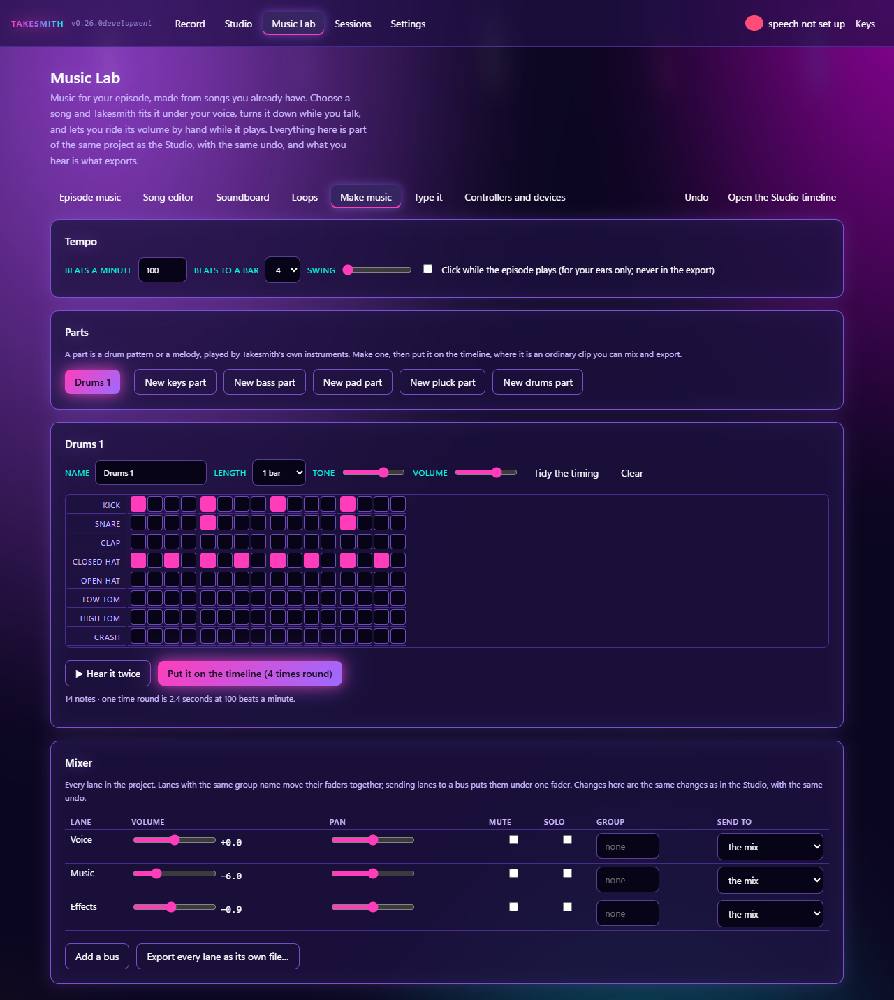

* **Type it:** say what you want in a sentence and see the list of changes before anything happens. One undo takes it all back.

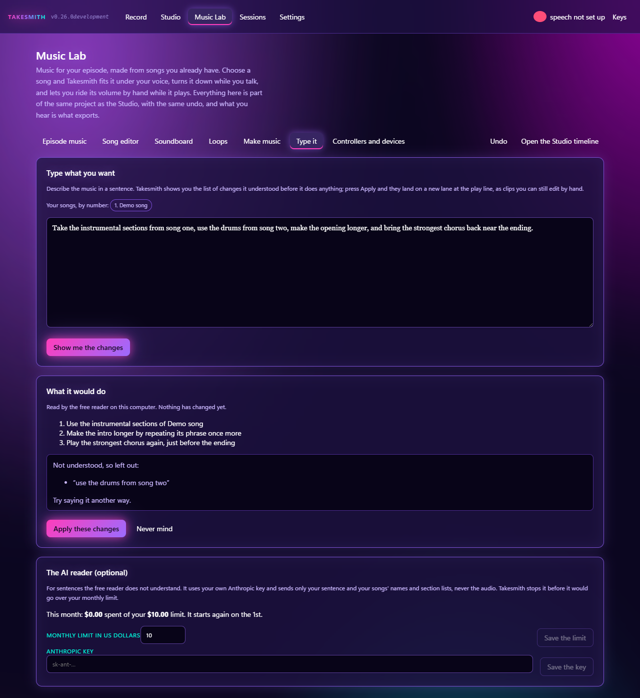

* **MIDI controllers** with learn, and honest tests for a USB mixer's line input and pads

Everything Music Lab makes ends up as ordinary clips on the timeline, so nothing it does is locked away from your hands.

## Bring Your Own Keys

Takesmith is designed around **BYOK**, or Bring Your Own Key.

Voice recognition uses a user-provided **Deepgram API key**.

An **ElevenLabs key is optional** for AI voice features.

An **Anthropic key is optional** for Music Lab's AI reader, and Takesmith holds it to a monthly spending limit you set, before anything is sent.

That means Takesmith does not need to quietly bundle someone else's expensive AI usage into a subscription just to make the core experience work.

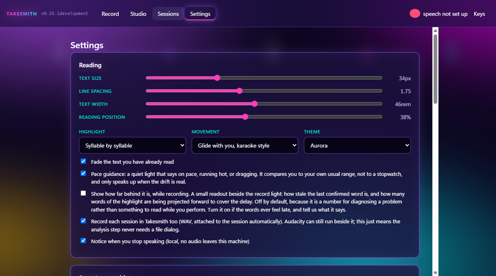

## Why I built it

I wanted to record spoken work without having to choose between sounding natural and staying on script.

Most teleprompters solve that problem by asking the speaker to adapt to the machine.

I wanted the machine to adapt to the speaker.

That idea turned into Takesmith.

## Current status

Takesmith is under active development and testing. The released build is **0.25.6**, which added two cameras switched with 1 and 2, after 0.25.5 added talking from points. Music Lab is **0.26.0**, built and in testing, and not released yet.

The core project is kept in a private repository while the software continues to be developed. This repository is the public home for information, screenshots, development updates, and future release information.

**This repository does not contain the private Takesmith source code.**

The pictures here are photographed from the real application, by a build that runs itself with nobody in front of it, so the page can be kept honest release by release rather than whenever somebody remembers.

---

**Built by Greygray with AI collaboration openly included in the process.**

Human judgment stays in the driver's seat.
